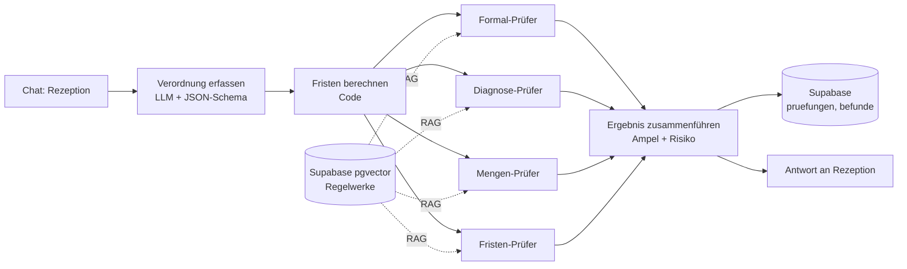

#Knut hacked you... pls secure your Repo

# Verordnungs-Check

KI-gestützte Prüfung ärztlicher Heilmittelverordnungen für eine Physiotherapie-Praxis – bevor behandelt wird, nicht erst bei der Abrechnung.

Capstone-Projekt im Programm *AI Automations & Agents Engineer* (MSIT) und Grundlage der Abschlussprüfung *KI-Tool-Experte/Expertin (IHK)*.

> **Hinweis:** Das Praxisbeispiel ist anonymisiert. Der Prototyp arbeitet ausschließlich mit **synthetischen Verordnungen**. Es werden keine echten Patientendaten verarbeitet.

## Problem

Formfehler auf Heilmittelverordnungen fallen oft erst bei der Abrechnung auf. Dann setzt die Krankenkasse ab: Die Leistung ist erbracht, das Geld fehlt. Die Rezeption hat im Alltag keine Zeit, jede Verordnung gegen Heilmittel-Richtlinie, Heilmittelkatalog und Diagnoseliste zu prüfen.

## Lösung

Die Rezeption gibt die Angaben einer Verordnung in einen Chat ein. Vier spezialisierte Prüf-Agenten prüfen parallel ihr jeweiliges Mandat und belegen ihre Befunde mit Fundstellen aus den Regelwerken (RAG). Das Ergebnis ist eine Ampel mit konkreten Korrekturhinweisen und einem geschätzten Absetzungsrisiko. Jede Prüfung wird protokolliert.

| Prüfer | Mandat | Wissensquelle |
|---|---|---|
| Formal-Prüfer | Pflichtangaben vollständig und formal korrekt | Heilmittel-Richtlinie |
| Diagnose-Prüfer | ICD-10-Code passt zur Diagnosegruppe, Leitsymptomatik, besonderer Verordnungsbedarf | Heilmittelkatalog, KBV-Diagnoseliste |
| Mengen-Prüfer | Höchstmenge je Verordnung, Heilmittel-Kombination, Frequenz | Heilmittelkatalog, Heilmittel-Richtlinie |
| Fristen-Prüfer | Behandlungsbeginn, Unterbrechung | Heilmittel-Richtlinie; Tage rechnet der Code |

Die Rezeption entscheidet. Das System gibt Empfehlungen, es weist nichts automatisch ab.

## Architektur

Details: [docs/architektur.md](docs/architektur.md)

## Technik

- **n8n** – Orchestrierung, Chat-Oberfläche, vier AI-Agenten
- **OpenAI** – `gpt-4.1-mini` für die Agenten, `text-embedding-3-small` für die Vektorsuche
- **Supabase** – PostgreSQL mit pgvector für die Wissensbasis und das Prüfprotokoll (EU-Region Frankfurt)

## Wissensquellen (frei zugänglich)

- Heilmittel-Richtlinie des G-BA, Fassung in Kraft seit 05.08.2025
- Heilmittelkatalog des G-BA (Zweiter Teil der Heilmittel-Richtlinie)
- Heilmittel-Diagnoseliste der KBV, Stand 01.01.2026
- ICD-10-GM 2026 (BfArM) – bewusst nicht vollständig im Repository, siehe Nutzungsbedingungen des BfArM

## Repository

| Ordner | Inhalt |
|---|---|
| `n8n/` | Exportierte Workflows (.json) |
| `supabase/migrations/` | Datenbankschema |
| `supabase/seed/` | Synthetische Testverordnungen (7 Testfälle + 3 Kontrollfälle) |
| `tests/` | Automatische Tests für den Code-Anteil (`node tests/fakten.test.mjs`) |
| `docs/` | Design-Briefing (Scope, Erfolgskriterien, Implementierungsweg, Architektur, Build-Plan), Dateneingang, Ist-Interview, Evaluation, Governance |

## Team

| Name | Rolle |
|---|---|
| Thomas Kullmann | Koordination, Ist/Soll-Analyse & Business Case |
| Valentin | Tools, Architektur & Governance |
| Derk | Build, Demo & Evaluation |

Seit 19.10.2026 arbeitet das Team zu dritt.

## Status

Prototyp läuft (Stand 13.10.2026):

- Wissensbasis geladen: HeilM-RL, Heilmittelkatalog, KBV-Diagnoseliste (rund 380 Abschnitte in Supabase)
- Vier Prüfer, Ampel und Protokoll funktionieren durchgängig, rund 24 Sekunden und 3–4 Cent je Prüfung
- Evaluation: 10 von 10 Ampeln korrekt, 0 kritische Fehlalarme (Baseline: 12), Details in [`docs/evaluation.md`](docs/evaluation.md)

Design-Briefing (Sprint 1): [Scope](docs/scope.md) · [Erfolgskriterien](docs/erfolgskriterien.md) · [Implementierungsweg](docs/implementierung.md) · [Architektur](docs/architektur.md) · [Build-Plan](docs/build-plan.md)

Geplant für Sprint 2: Verordnungsfall-Prüfung (Folgeverordnungen, orientierende Behandlungsmenge), siehe [`docs/dateneingang.md`](docs/dateneingang.md). Foto-Upload nur bei Puffer.

IHK-Präsentation, Arbeitsstand 19.10.2026 (20 Folien, teils Entwurf): [PowerPoint](docs/praesentation/Verordnungs-Check_IHK_Arbeitsstand_2026-10-19.pptx) · [PDF](docs/praesentation/Verordnungs-Check_IHK_Arbeitsstand_2026-10-19.pdf)

Statusmeldung an MSIT (19.10.2026): [PowerPoint](docs/status/Verordnungs-Check_Status_MSIT_2026-10-19.pptx) · [PDF](docs/status/Verordnungs-Check_Status_MSIT_2026-10-19.pdf)

Field Study: Ist-Interview am 16.10.2026, Ergebnisse in [`docs/ist-interview.md`](docs/ist-interview.md). Kernbefund: ca. 90 % der Fehler entstehen bei Doppel- und Folgeverordnungen.

Offen: Business Case, EU-AI-Act-Einordnung, Präsentation.
